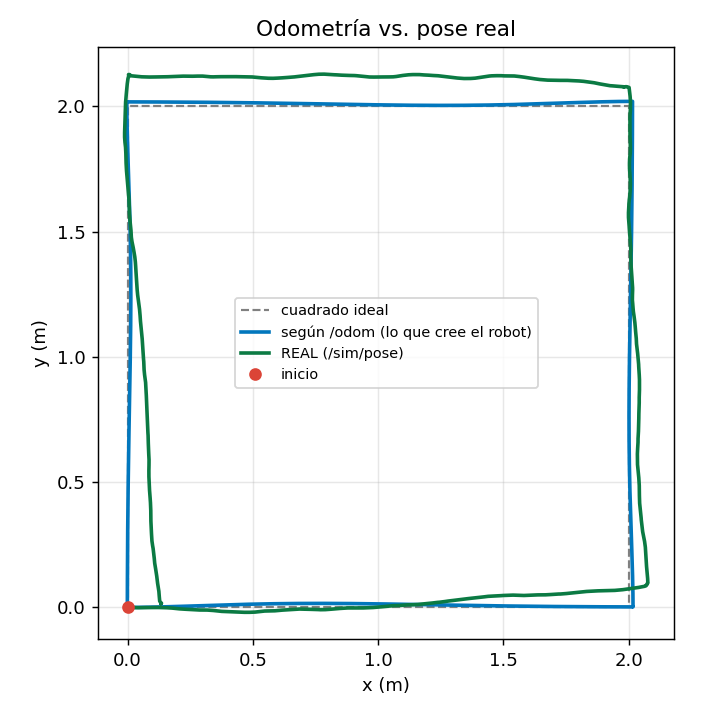

# 0. Para qué sirve este documento

Explica, pieza por pieza, **qué hace cada código y cada script del Reto 1**, qué recibe, qué produce, qué parte **mueve** al robot, quién lo **detiene** y quién **documenta** cada cosa, y resume el **avance** hecho en el simulador y con el robot real. Todo lo que se afirma sobre el robot real sale de lo observado en el laboratorio (terminales, CSV y mediciones guardadas en el repositorio); lo que no se pudo inspeccionar se marca como tal.

**Etiquetas de confianza:** [Seguro] observado o leído en el código; [Probable] inferencia fuerte; [Por confirmar] no se pudo comprobar.

## 0.1 Resumen en una tabla: quién mueve, quién para, quién documenta

| Pregunta | Simulador (casa) | Robot real (laboratorio) |
|---|---|---|
| ¿Quién **decide** las velocidades? | `cuadrado_controller.py` (usa `core_cuadrado.py`): PID sobre `/odom` | El mismo nodo, sin modificar |
| ¿Quién **mueve** el robot? | `sim_robot` (`sim_node.py` + `vehicle.py`): integra la cinemática con límites de aceleración | `YB_Car_Node` recibe `/cmd_vel` y comanda los motores de la placa [Seguro: es el único suscriptor de `/cmd_vel`] |
| ¿Quién **produce `/odom`**? | `sim_robot` (50 Hz, con error por nivel de ruido) | `odom_corrector` a partir de `/odom_raw` (≈ 11 Hz) |
| ¿Quién da la **verdad terreno**? | `/sim/pose` (lo lee `cierre_real.py`) | Cinta métrica y transportador, a mano |
| ¿Quién **para** al terminar bien? | El nodo: al llegar a `FIN` publica `v = 0` y `ω = 0` en cada tick | Igual |
| ¿Quién para si **deja de llegar `/odom`**? | El nodo: a los 0.5 s sin `/odom` publica `Twist()` en cero | Igual |
| ¿Quién para si el **nodo muere** (Ctrl+C antes de `FIN`)? | `sim_robot`: `cmd_timeout` = 0.5 s sin `/cmd_vel` → velocidad 0 | **Nadie, por sí solo.** El robot conserva la última orden (observado el 12-nov). Se compensa con `timeout`, una orden de ceros a continuación y una persona en el interruptor |
| ¿Quién **documenta**? | CSV del nodo (`log_csv`), `cierre_real.py` (CSV y PNG), `09_plot_csv.py`, `hoja_resultados.csv`, `rc1_anotar.py` | CSV del nodo, mediciones a mano, `hoja_resultados.csv`, `registro_E5_giro_real.md`, predicciones en git |

# 1. Visión general

El reto es **un lazo de control cerrado sobre la odometría**: el nodo del curso lee dónde cree el robot que está (`/odom`), calcula el error respecto de una línea virtual o de un ángulo objetivo, y manda velocidades (`/cmd_vel`). Lo que cambia entre el simulador y el robot real es la **planta** que hay detrás de `/cmd_vel` y `/odom`.

{width=95%}

{width=95%}

## 1.1 Diferencias de planta que importan

| Aspecto | Simulador | Robot real |
|---|---|---|
| Frecuencia de `/odom` | ≈ 50 Hz | ≈ 11.1 Hz (períodos 0.07–0.15 s) |
| Origen de `/odom` | Integra la velocidad real con un error por nivel de ruido (`noise:=low` → 1 %) | Encoders de las 4 ruedas, corregidos por `odom_corrector` con `r` y `b_eff` propios |
| Derrape de las 4 ruedas al girar | No existe | Existe: `b_eff = χ·b` |
| Verdad terreno | `/sim/pose` | Cinta y transportador |
| Parada si falla el mando | `cmd_timeout` 0.5 s | No hay |
| Velocidades usadas | 0.20 m/s, `max_angular` 2.0 | 0.10 m/s, `max_angular` 1.0 (velocidades suaves del documento) |

# 2. El simulador `yahboomcar_sim`

Paquete ROS 2 en `yahboomcar_ws/src/yahboomcar_sim/`. Es un simulador **2D**: no modela inercia, derrape ni par de los motores; sí limita velocidad y aceleración, simula colisión y un **empujón aleatorio del piso** que gira al robot y que `/odom` no ve.

| Archivo | Qué hace | Recibe | Produce |
|---|---|---|---|
| `yahboomcar_sim/sim_node.py` (nodo `sim_robot`) | Núcleo del simulador. Un temporizador a `update_rate` = 50 Hz llama a `_update`: aplica el último `/cmd_vel` (o cero si es más viejo que `cmd_timeout` = 0.5 s), avanza el vehículo y publica | `/cmd_vel`, `/initialpose`, `/beep`; servicio `/sim/reset` | `/odom` + TF `odom→base_footprint`, `/sim/pose` (verdad), `/scan`, `/imu/data_raw`, `/vel_raw`, `/voltage`, `/camera/*`, `/sim/collision`, `/race/*` |
| `vehicle.py` | **Lo que mueve al robot virtual.** Cinemática con límites (`accel_lin` 2.5 m/s², `accel_ang` 8 rad/s²), colisión con el mapa, odometría con error multiplicativo y empujón del piso | velocidad ordenada | pose real y pose de odometría |
| `world.py` | Lee mapas tipo `map_server` (`.yaml` + `.pgm`) | archivo de mapa | rejilla de ocupación |
| `race.py`, `track.py`, `track_gen.py`, `camera.py` | Pista, vueltas, cronómetro y cámara simulada (no se usan en el RC-1, que va en la arena abierta) | pose | estado de la carrera, imagen |
| `pilot.py`, `autopilot_node.py` | Piloto automático de referencia (no se usa en el RC-1) | pose | `/cmd_vel` |
| `launch/sim.launch.py` | Lanza TF estático `map→odom`, `sim_robot`, el piloto (opcional) y RViz; define los argumentos `world`, `start`, `noise`, `rviz`, etc. | argumentos | procesos |
| `worlds/arena_rc1.{pgm,yaml}` | Arena abierta de 4 × 4 m del RC-1 | – | – |
| `test/test_core.py` | 25 pruebas del núcleo sin ROS | – | informe de `unittest` |

**Niveles de ruido** (`noise:=`): `none`, `low` (empuje del piso 0.02 m/s, error de odometría 1 %), `medium` (0.04 m/s, 2 %), `high` (0.10 m/s, 5 %). El trabajo del RC-1 se hizo con `low` y una corrida de cada prueba con `medium`.

**Cómo se lanza para el RC-1:**
```bash
ros2 launch yahboomcar_sim sim.launch.py world:=arena_rc1 start:=1.0,1.0,0.0 \
    robot_radius:=0.14 noise:=low rviz:=false
ros2 service call /sim/reset std_srvs/srv/Empty     # entre corridas
```

# 3. El robot real: qué hay detrás de `/cmd_vel` y `/odom`

Observado en la Raspberry Pi 5 (`pi@roscar4`, acceso por SSH a `10.42.0.1`, `ROS_DOMAIN_ID=8`):

| Pieza | Dónde corre | Qué hace | Recibe | Produce |
|---|---|---|---|---|
| `YB_Car_Node` | contenedor `ros2_dev` | Driver de la placa del robot. **Es quien mueve los motores** [Seguro: es el único suscriptor de `/cmd_vel`; el mecanismo con la placa no se inspeccionó] | `/cmd_vel` | `/odom_raw` [Seguro]. En la lista de topics del robot también están `/imu`, `/battery`, `/scan`, `/beep`, `/servo_s1` y `/servo_s2` [Por confirmar: no se comprobó qué nodo publica o recibe cada uno] |
| `micro_ros_agent` | contenedor aparte | Enlace entre ROS 2 y la placa [Por confirmar: no se inspeccionó cómo se conecta con `YB_Car_Node`] | – | – |
| `odom_corrector` | contenedor `ros2_dev` (paquete `capytown_esan`, lanzado con `bringup.launch.py`) | Reescala la odometría de fábrica con los parámetros de las ruedas | `/odom_raw` (best effort), `/odom_reset` | `/odom` y TF `odom→base_footprint` |
| `bringup.launch.py` | paquete `capytown_esan` | Lanza `odom_corrector` con el archivo del argumento `wheel_params` | `wheel_params:=<ruta>` | el nodo |
| `wheel_params_g8.yaml` (en el repositorio) | se copia al contenedor | Calibración propia del grupo | – | parámetros de `odom_corrector` |
| Interruptor del robot | físico | **El único paro garantizado** | persona | corta los motores |

[Seguro] El paquete `capytown_esan` está instalado en el Pi desde el espacio de trabajo `Grupo7-S003`; **no está en nuestro repositorio**. Por eso lo documentado aquí sale del `ros2 param dump` y de los logs, no del código fuente.

**Parámetros de `odom_corrector` y cálculo [Seguro, verificado con el log]:**

```
firmware_wheel_radius = 0.0325   firmware_wheel_separation = 0.24   (de fábrica)
wheel_radius          = 0.03145  wheel_separation          = 0.2138  (calibración del grupo)
k_lin = wheel_radius / firmware_wheel_radius                            = 0.9677
k_ang = (wheel_radius / wheel_separation) / (firmware_r / firmware_b)   = 1.0863
log:  /odom_raw -> /odom | r=0.0314 (r0=0.0325) b_eff=0.2138 (b0=0.2400) k_lin=0.9677 k_ang=1.0863
```

El Pi **no tiene reloj con batería** (`RTC time` = 1970): la hora hay que ponerla a mano en cada sesión (`timedatectl set-time`), y el contenedor la hereda del host.

**Cómo se lanza en el laboratorio:**
```bash
docker exec -it ros2_dev bash
source /opt/ros/humble/setup.bash; source /root/yahboomcar_ws/install/setup.bash
export ROS_DOMAIN_ID=8
ros2 launch capytown_esan bringup.launch.py wheel_params:=/root/wheel_params_g8.yaml
```

# 4. El código del curso (no se modifica)

El nodo del docente se copia en `scripts_pdi/` (que `.gitignore` excluye porque no es nuestro). Se comprueba que es el original con `sha256sum`: `cuadrado_controller.py` empieza por `d618e71722c4153d` y `core_cuadrado.py` por `a45a46afa2d36913`.

## 4.1 `core_cuadrado.py` — la lógica (sin ROS)

| Elemento | Qué hace |
|---|---|
| `PID` | `u = Kp·e + Ki·∫e + Kd·de/dt` en discreto. `integral += e·dt`, limitada a ±`i_limit` (0.5, anti-windup); la derivada es `(e − e_ant)/dt` y vale 0 en la primera muestra |
| `Params` | Todos los parámetros (tabla 4.3). Es la fuente de los valores por defecto |
| `Runner` | Máquina de estados `ESPERA → AVANZA ⇄ GIRA → FIN`. `update(x, y, yaw, dt)` devuelve `(v, w, info)` |
| `simular`, `Planta` | Simulador de laptop (uniciclo con retardo de actuador y de pose). Lo usa `08_cuadrado_sim.py`, y nosotros lo usamos para el razonamiento de E6 |
| `metricas` | Sobreimpulso, asentamiento ±2 cm / ±2°, error final, cierre. Lo usa `09_plot_csv.py` |

**Cómo calcula la orden** (`Runner.update`):

```
RECTA (estado AVANZA):  d = desvío lateral al segmento (d > 0: a la izquierda)
                        e_line = d + line_offset
                        w = −PID(e_line)               (e > 0 → girar a la derecha)
                        termina cuando s ≥ side (2.0 m)      s = avance sobre la línea
GIRO  (estado GIRA):    e_yaw = normalizar(yaw_objetivo − yaw)
                        w = +PID_yaw(e_yaw)
                        termina cuando |e_yaw| < 2° durante 0.3 s seguidos
SALIDA:                 w = clamp(w, ±max_angular) + bias_w        (el sesgo va DESPUÉS del recorte)
FIN:                    v = 0, w = 0, y calcula el cierre = distancia al punto de inicio
```

En `cuadrado_abierto` no hay realimentación: avanza `side/v` segundos y gira un tiempo fijo `(π/2)/(turn_w·turn_scale)`.

## 4.2 `cuadrado_controller.py` — el nodo ROS 2

Envuelve a `core_cuadrado.py`: no tiene lógica de control propia.

| | |
|---|---|
| **Recibe** | `/odom` (`nav_msgs/Odometry`; cambiable con `-p odom_topic:=`) |
| **Produce** | `/cmd_vel` (`Twist`: **es lo que mueve al robot**), `/line_error` y `/yaw_error` (`Float32`), un CSV si se da `-p log_csv:=` (columnas `t, x, y, yaw, v, w, e_line, e_yaw, estado`) |
| **Ritmo** | Temporizador a 30 Hz (`control_rate`). Con `/odom` a 11 Hz el controlador usa la misma pose varias veces seguidas |
| **Seguridad** | Si no hay `/odom` o tiene más de 0.5 s (`odom_timeout`), publica `Twist()` en cero. Al salir (`finally`) intenta publicar `Twist()` en cero |
| **Qué imprime** | `FIN. error de cierre = … cm, yaw acumulado = … deg, tiempo = … s` |

**Dos comportamientos que descubrimos en el robot real:**

1. **Tras `FIN` el nodo sigue escribiendo filas `FIN` en el CSV** hasta que se pulsa Ctrl+C (los CSV crecen mucho si se tarda). Por eso `09_plot_csv.py` parcheado descarta esas filas en la recta.
2. **El paro «al salir» falla con Ctrl+C o `timeout`.** rclpy ya cerró el contexto cuando el `finally` intenta publicar y sale `RCLError: publisher's context is invalid`. En el simulador no importa (`cmd_timeout`). En el robot real **la última orden queda pegada**: el 12-nov el robot siguió girando hasta que se mandaron ceros por otro terminal. Desde entonces cada corrida lleva a continuación `ros2 topic pub -r 10 -t 30 /cmd_vel … "{}"`.

## 4.3 Parámetros principales del nodo (`-p clave:=valor`, siempre con punto decimal)

| Parámetro | Por defecto | Qué hace |
|---|---|---|
| `experimento` | `cuadrado` | `recta`, `giro90`, `cuadrado`, `cuadrado_abierto` |
| `linear_speed` | 0.20 | Velocidad hacia adelante (m/s); 0.10 en el robot real |
| `kp`, `ki`, `kd` | 3.0, 0.0, 4.0 | PID de la línea (error en metros) |
| `kp_yaw`, `ki_yaw`, `kd_yaw` | 3.0, 0.0, 0.4 | PID del giro (error en radianes) |
| `max_angular` | 2.0 | Tope de ω (rad/s); 1.0 en el robot real |
| `line_offset` | 0.0 | La línea virtual queda a esta distancia a la derecha; 0.10 en la recta |
| `bias_w` | 0.0 | Sesgo de motores inyectado (rad/s); solo se usa en el simulador |
| `side` | 2.0 | Largo de cada lado (m) |
| `log_csv` | `""` | Archivo CSV de la corrida |
| `odom_timeout` | 0.5 | Segundos sin `/odom` antes de frenar |

Otros scripts de `scripts_pdi/` (`01`…`08`, `10`, `11`) son material de práctica del curso; no forman parte del flujo del RC-1.

# 5. El código y los archivos del grupo

| Archivo | Qué hace | Recibe | Produce | Quién / cuándo |
|---|---|---|---|---|
| `config/rc1_pid.yaml` | Ganancias en dos bloques (`simulador`, `robot_real`) con `estado: PENDIENTE/FINAL` | edición del grupo | valores | Se edita al decidir ganancias |
| `scripts/rc1_args.py` | Convierte un bloque del YAML en banderas `-p` con punto decimal (evita `kd:=0`); los `clave=valor` extra las pisan | `simulador` o `robot_real` + overrides | texto `-p ...` para `$(...)` | Cada corrida |
| `docs/rc1/cierre_real.py` | **Cinta métrica virtual del simulador.** Registra `/sim/pose` y `/odom` a 20 Hz; al terminar imprime el cierre y el yaw acumulado según cada una | `/sim/pose`, `/odom` | CSV, PNG «odometría vs. pose real» | Se lanza **antes** del nodo, solo en el simulador |
| `docs/rc1/09_plot_csv.py` | Métricas y gráfica de un CSV del nodo (copia **parcheada**: descarta las filas `FIN` en la recta). Necesita `core_cuadrado.py` en `PYTHONPATH` | CSV del nodo | métricas por pantalla, PNG | Después de cada corrida |
| `scripts/rc1_anotar.py` | Anota el resultado de una corrida del Experimento 3 en la hoja (identifica la fila por la etiqueta `run1/run2/run3/medium`) | prueba, corrida, cierres, yaw | actualiza `hoja_resultados.csv` | Tras cada corrida 3A/3B/3C |
| `scripts/rc1_anotar_real.py` | Como `rc1_anotar.py` pero para el **robot real** (E5, E6, E7): crea o actualiza la fila de una corrida (por la etiqueta `run1/run2/run3/exp1/unica`) con `desvio_cm`, `e_fin_deg`, `cierre_real_cm`, etc.; no toca la predicción | prueba, etiqueta, `clave=valor` | actualiza `hoja_resultados.csv` | Tras medir con cinta o transportador |
| `scripts/rc1_correr.sh` | **Lanza una corrida del robot real** con las comprobaciones (hash del nodo, un solo `/odom_corrector`, batería, hora, archivos que no existan), el bag (3A/3B), el `timeout`, la orden de ceros al terminar o cortar y el log del nodo; propone el comando de `rc1_anotar_real.py` con los valores de `FIN`. No modifica el nodo | `giro/recta/3a/3b`, nombre, overrides | CSV del nodo, bag, `<csv>.nodo.log` | En cada corrida, dentro del contenedor |
| `scripts/rc1_analiza_real.py` | **Análisis automático de uno o varios CSV del nodo** (simulador o real): detecta giro, recta o cuadrado y calcula tiempo hasta `FIN`, errores de línea, cruces, permanencia en ±2 cm, inversiones de `w`, yaw acumulado, cierre según `/odom` y, en el cuadrado, cada lado y cada giro; contrasta con los criterios de las predicciones (`--criterios e5/e6/e7a/e7b`), dibuja la gráfica (`--png`) y propone el comando de `rc1_anotar_real.py`. Lo que mide sale de `/odom`: no sustituye la cinta ni el transportador | CSV del nodo | informe por pantalla, JSON, PNG | Después de cada corrida |
| `scripts/rc1_tablas.py` | Tablas Markdown de los Experimentos 1, 2 y 3 desde la hoja y los CSV | hoja, CSV | texto Markdown | Al armar el informe |
| `scripts/rc1_figuras_giro.py` | Las dos figuras del Experimento 2 (predicción reconstruida y comparación con lo medido) | hoja, CSV | `plots/prediccion_giro_reconstruida.png`, `plots/giro_prediccion_vs_medicion.png` | Al armar el informe |
| `scripts/rc1_verificar.py` | Estima el avance contra la rúbrica (E1…E8, informe); solo lectura | archivos del repositorio | porcentaje por criterio | Cuando se quiere saber qué falta |
| `scripts/rc1_informe_pdf.sh` | `informe.md` → HTML (pandoc) → `informe.pdf` de 1 página (Chromium) | `informe.md`, `docs/rc1_g8/informe.css` | `informe.pdf` | Al terminar el informe |
| `hoja_resultados.csv` | **Registro central:** una fila por prueba con ganancias, predicción, resultados y notas (`clave=valor;`) | – | – | Se escribe en cada parte |
| `wheel_params_g8.yaml` | Calibración propia de `odom_corrector` | – | – | Se carga con `wheel_params:=` |
| `docs/rc1_g8/predicciones_*.md`, `razonamiento_E6.txt` | Predicciones previas y su razonamiento (el commit de git fija la hora) | – | – | Antes de cada prueba |
| `docs/rc1_g8/registro_E5_giro_real.md` | Registro de todas las corridas del giro real, el criterio del docente y la corrida que acredita E5 | – | – | Durante E5 |
| `docs/rc1_g8/tablas_*.md`, `avance_parte*.txt`, `transferencia.md`, `laboratorio_E_F.md` | Tablas, avances por parte, tabla de transferencia y plantilla de las Partes E y F | – | – | Al cerrar cada parte |
| `informe.md` / `informe.pdf` | Informe de 1 página (a–e) | – | – | Entregable |
| `sim_log.txt`, `plots/rqt_graph_sim.png` | Evidencia de E1: `/odom` ≈ 50 Hz y diferencia odom vs. real; captura de `rqt_graph` | – | – | Parte A |

## 5.1 La hoja de resultados

Columnas: `prueba, planta, noise, kp, ki, kd, kp_yaw, ki_yaw, kd_yaw, prediccion, cierre_odom_cm, cierre_real_cm, yaw_acum_deg, notas`. `planta` es `sim` o `real`. Las métricas se escriben en `notas` como `clave=valor;` (por ejemplo `desvio_cm=`, `e_fin_deg=`, `sobre_pct=`) para que `rc1_verificar.py` pueda comprobar los umbrales.

# 6. Una corrida de punta a punta

## 6.1 Simulador (Experimento 3, cuadrado)

| Paso | Quién | Qué pasa |
|---|---|---|
| 1 | `sim.launch.py` | Arranca `sim_robot` en la arena de 4 × 4 m |
| 2 | Persona | `ros2 service call /sim/reset …` pone el robot en la salida |
| 3 | Persona | Lanza `cierre_real.py` (antes del nodo) |
| 4 | Persona | `python3 scripts_pdi/cuadrado_controller.py --ros-args $(python3 scripts/rc1_args.py simulador …)` |
| 5 | `cuadrado_controller.py` | Lee `/odom`, calcula `(v, ω)` y publica `/cmd_vel` a 30 Hz |
| 6 | `sim_robot` | Aplica `/cmd_vel`, mueve el robot virtual, publica `/odom` y `/sim/pose` |
| 7 | Nodo | Al terminar imprime `FIN …` y publica ceros; persona pulsa Ctrl+C en el nodo y en `cierre_real.py` |
| 8 | `cierre_real.py` | Imprime el cierre según `/odom` y el REAL; guarda CSV y PNG |
| 9 | Persona | `rc1_anotar.py` anota en la hoja; `09_plot_csv.py` hace la gráfica |

## 6.2 Robot real (Experimentos 2 y 1, giro y recta)

| Paso | Quién | Qué pasa |
|---|---|---|
| 1 | Persona | Hora del Pi, bringup con `wheel_params_g8.yaml`; comprobación de un solo `/odom_corrector`, batería, hash del nodo |
| 2 | Persona | Marca el piso (rumbo, línea de 2.4 m a 10 cm del robot) y posiciona el robot contra un tope fijo |
| 3 | Persona | `timeout -s INT … python3 scripts_pdi/cuadrado_controller.py … log_csv=csv/…; ros2 topic pub -r 10 -t 30 /cmd_vel … "{}"` |
| 4 | `cuadrado_controller.py` | Igual que en el simulador, con `linear_speed` 0.10 y `max_angular` 1.0 |
| 5 | `YB_Car_Node` | Convierte `/cmd_vel` en movimiento de los motores y publica `/odom_raw` |
| 6 | `odom_corrector` | Publica `/odom` ≈ 11 Hz con la calibración propia |
| 7 | Nodo / persona | `FIN` → ceros; si se corta antes, la orden de ceros posterior y el interruptor son el paro |
| 8 | Dos personas | Miden con transportador (giro) o con cinta (desvío lateral) |
| 9 | Persona | El CSV se copia del contenedor al host y al clon (`docker cp`, `scp`) y se sube con git; `09_plot_csv.py` hace la gráfica; la hoja se anota |

# 7. El avance

## 7.1 Simulador (Partes A–D): hecho

| Parte / rúbrica | Qué se hizo | Resultado clave |
|---|---|---|
| A · E1 | Simulador instalado, `/odom` a ≈ 50 Hz, `sim_log.txt` y captura de `rqt_graph` | Hecho |
| B · E2 (recta, `noise:=low`) | 1A bang-bang, 1B solo P, 1C P+D, 1D PID (Kp 3, Ki 0.5, Kd 4, `bias_w` 0.06) | 1D: error final **0.30 cm**, asentamiento 5.80 s (meta ≤ 2 cm). Casi idéntico al de referencia del docente |
| C · E3 (giro de 90°) | 2a, 2b, 2c y tres combinaciones propias | 2p (Kp 10, Kd 0.6): sobreimpulso 0 %, asentamiento **1.01 s** (meta ≤ 10 % y ≤ 3 s) |
| D · E4 (cuadrado 2 × 2 m) | 3A lazo abierto, 3B PID, 3C PID + Ki, cada una con 3 corridas `low` y 1 `medium` (12 corridas) | Cierre real medio (`low`): 3A 16.1 cm, 3B 58.7 cm, 3C 30.1 cm. `/odom` decía < 1 cm en 3B y 3C |

{width=70%}

**Lección del simulador [Seguro]:** el PID cierra el lazo sobre `/odom`, y `/odom` no ve el empujón del piso. Por eso el cierre «según `/odom`» es casi perfecto y el real no lo es.

## 7.2 Robot real (Partes E y F)

### E5 — giro de 90° (hecho)

| Qué se hizo | Resultado |
|---|---|
| Calibración de `odom_corrector` (`r` 0.03145, `b_eff` 0.2138) cargada con `wheel_params:=` | `k_ang` = 1.0863 |
| Giro con las ganancias del simulador (Kp 10, Kd 0.6), ruedas en el aire y en el piso | No se asienta: oscilación sostenida de ±15–20°, período ≈ 2.6 s, por el retardo de `/odom` y de los motores |
| **Re-sintonía #1** (de las 3 permitidas): `kp_yaw` 10 → 1.0 | `FIN` en 5.0–8.7 s, sin sobreimpulso |
| Siete corridas medidas con transportador | 85°, 90°, 87°, 83°, 93°, 91°, 88°: media 88.1°, desviación ≈ 3.5° |
| **Evidencia que acredita E5** (el docente acepta una prueba) | Corrida `r3`: 91° (error 1°); todas las demás siguen registradas, incluidas las dos fuera de ±3° |

{width=90%}

### E6 — recta real (pendiente de las corridas)

Hecho: predicciones de la corrida experimental 1 subidas (`docs/rc1_g8/predicciones_E6_exp1.md`, commit `10c9a56`), razonamiento con el modelo de la recta con retardo (`razonamiento_E6.txt`), montaje y comandos preparados. Falta: las corridas, las medidas con cinta, los CSV y las gráficas. Criterio del docente: tres corridas, con al menos una con desvío lateral final < 5 cm.

### E7 y bonus — cuadrado real (pendiente)

3A una vez y 3B tres veces, con cinta y bags; cierre medio de 3B ≤ 25 cm y menor que el de 3A. Aún no se han hecho.

### Lo aprendido al pasar al robot real

1. **Retardo y frecuencia:** `/odom` a ≈ 11 Hz y un retardo efectivo de ≈ 0.5–0.65 s en la orden de giro [Probable: estimado a partir del período de la oscilación]. Con las ganancias del simulador el lazo oscila; hubo que bajar `kp_yaw`.
2. **Derivada con datos repetidos:** el nodo corre a 30 Hz pero `/odom` cambia cada ≈ 0.09 s; la derivada llega en ráfagas y aparece «chatter» pequeño de `w` en la cola de la respuesta (en nuestras predicciones el criterio de ≤ 2 inversiones de `w` no se cumplió).
3. **Calibración:** con los valores de ruedas que traía el robot (`r` 0.0316, `b_eff` 0.2332, de otro espacio de trabajo) se estimó un error físico de ≈ 8° en un giro de 90° [Probable: cálculo, no medido]; con la calibración propia no se vio sesgo sistemático en las siete medidas.
4. **Medición:** la dispersión de 75°–95° de las primeras medidas era del método (cinta bajo las ruedas, lectura del transportador), no del robot; con transportador circular y el robot en el centro del cuadrante bajó a ≈ ±3.5°.
5. **Seguridad:** el robot real no se detiene solo si el nodo muere (sección 4.2); el interruptor y la orden de ceros posterior son obligatorios.

## 7.3 Incidentes de la sesión del 12-nov (para que consten)

| Incidente | Qué pasó | Qué se hizo |
|---|---|---|
| Nodo modificado | Se editó `cuadrado_controller.py` dentro del contenedor | Se restauró desde la copia original y se verificó el hash |
| Dos `odom_corrector` | Un bringup congelado siguió publicando y se lanzó otro | Se mató el proceso por nombre y se comprobó un solo publicador |
| Batería agotada y reinicio del Pi | Se perdió la hora y el bringup | Se volvió a poner la hora y se relanzó con el YAML propio |
| Robot que no se detiene | Un corte por `timeout` dejó la última orden | Orden de ceros tras cada comando; persona en el interruptor |
| CSV sobrescritos | No se cambió la variable `N` | Un `N` explícito por corrida; las corridas perdidas quedan solo como `FIN` transcrito en el registro |

# 8. Dónde está cada cosa

```
config/rc1_pid.yaml                 ganancias (simulador / robot real)
wheel_params_g8.yaml                calibración propia del robot real
hoja_resultados.csv                 registro central
csv/                                CSV del nodo (exp1*, exp2*, exp3*, exp2_real_*) y de la cinta virtual (…_cinta_*)
plots/                              PNG de cada corrida y figuras de comparación
scripts/                            rc1_args, rc1_anotar, rc1_tablas, rc1_figuras_giro, rc1_verificar, rc1_informe_pdf.sh
docs/rc1/                           cierre_real.py, 09_plot_csv.py parcheado, figura de arquitectura
docs/rc1_g8/                        predicciones, registros, tablas, avances, transferencia, este documento
informe.md / informe.pdf            informe de 1 página
scripts_pdi/                        (NO está en git) nodo del curso: cuadrado_controller.py y core_cuadrado.py
```

# 9. Límites y pendientes honestos

- El paquete `capytown_esan` (con `odom_corrector` y `bringup.launch.py`) no está en nuestro repositorio; lo descrito sale de observar el robot.
- Cómo se enlazan `YB_Car_Node`, el agente micro-ROS y la placa **no se inspeccionó**.
- El retardo efectivo de ≈ 0.65 s es una estimación a partir de la oscilación de un giro, no una medida directa.
- Falta cerrar E6, E7, el bonus, el informe final, la tabla de transferencia con datos del robot y las ganancias finales en `config/rc1_pid.yaml`.
- En la sustentación en vivo cada parte (E5 a E7) tiene **una sola corrida**; con la repetibilidad medida en E5 (≈ 70 % de las corridas dentro de ±3°), conviene ensayar el procedimiento completo antes.

# Anexo: glosario rápido

| Término | Significado |
|---|---|
| `e_line` | Error lateral a la línea virtual (m): `d + line_offset`; `e > 0` = a la izquierda |
| `e_yaw` | Error de rumbo en el giro (rad): `yaw_objetivo − yaw` |
| `/odom` | Pose que cree el robot (integra las ruedas); en el robot real, la que publica `odom_corrector` |
| `/sim/pose` | Pose real del simulador (verdad terreno); no existe en el robot real |
| `cierre` | Distancia entre el punto de inicio y el final de un recorrido cerrado |
| `b_eff` | Separación efectiva entre ruedas, `χ·b`; incluye el derrape |
| `FIN` | Estado final de la máquina de estados del nodo |
