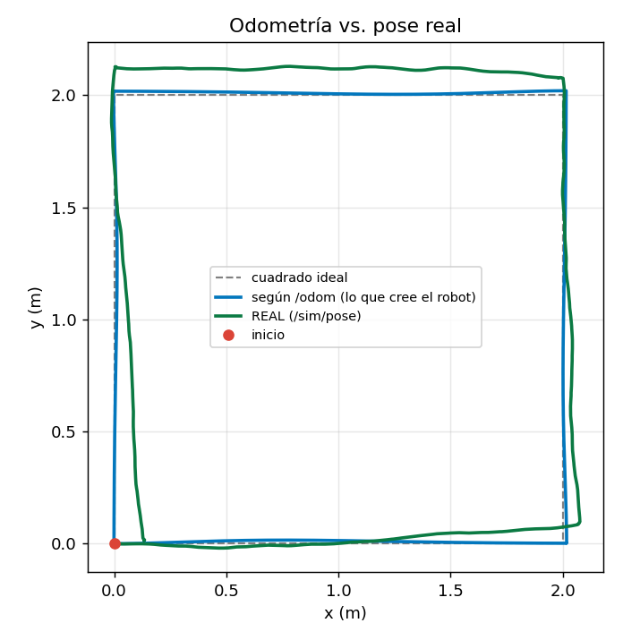

# RC-1 — Control PID: del simulador al robot real

**Grupo 8 · S-003** · Integrantes: [COMPLETAR] · RosCar 4 · `ROS_DOMAIN_ID=8` · ruido `low` y `medium` · ganancias finales del real: línea `1.0 / 0.1 / 8.0`, giro `1.0 / 0 / 0.3` (`config/rc1_pid.yaml` se actualiza al cerrar E7) · **Estado: simulador, E5, E6 y 3A terminados; 3B oficial (E7) pendiente (celdas `[ ]`)**

## (a) Predicción frente a medición (escritas antes de correr, salvo donde se indica)

| Pregunta | Predijimos | Medimos | ¿Se cumplió? |
|---|---|---|---|
| 1. Recta, solo P | ≥ 2 cruces; equilibrio en ≈ +2 cm (0.06/3); Kd amortigua | 1B: 2 cruces, centro +2.17 cm; 1C: 0 cruces, residuo ≈ 2.1 cm; 1D (Ki): 0.30 cm | Sí |
| 2. Cuadrado PID, `low`: cierre `/odom` / real | 5 / 20 cm; real > `/odom` | 3B: 0.3–1.0 / 37–89 cm; 3C: 0.1–0.7 / 13–42 cm | Dirección sí; real subestimado en 3B |
| 3. 1° de error de yaw | 3.49 cm en un lado; 9.79 cm en cuatro lados | El yaw real difirió del de `/odom` entre 1° y 31° | Escala: ≈ 10 cm por grado por esquina |
| 4. Mismas ganancias en el robot | Giro más lento en el real (motores, `/odom` a ≈ 11 Hz, `max_angular` 1.0) | Con `kp_yaw` 10 oscila ±15–20° (T ≈ 2.6 s); con 1.0: `FIN` en 5.0–8.7 s (simulador: 1.01 s) | Sí (mucho más lento) |
| 5. E5: giro real, `kp_yaw` 1.0 (tras 10 corridas exploratorias) | ≈ 6 s; sobreimpulso ≈ 1°; ángulo físico 75°–95° | `FIN` 5.0–8.7 s; sin sobreimpulso; físico 83°–93° | Parcial: tiempo y rango sí; sobreimpulso no |
| 6. E6: recta real, Kp 3 / Ki 0.5 / Kd 4 | ≈ 13 cm; ≥ 3 cruces | Oscila ±13 cm (4 cruces); campanas de ≈ 30 cm | Sí (oscilación y cruces) |
| 7. E7-3A: lazo abierto | Real ≈ 75 cm (30–125); ≈ 98° por esquina; ≈ 88 s | **107.9 cm**; 1.ª esquina ≈ 115°, otras ≈ 88°; 87.9 s | Parcial: en rango, exceso en la 1.ª esquina |
| 8. E7-3B: PID sobre `/odom` | Media ≈ 27 cm (P ≤ 25 ≈ 25–30 %) | [pendiente: tres oficiales] | [ ] |

## (b) Hoja de resultados (`hoja_resultados.csv`)

| Prueba | Ganancias | Simulador (`low`) | Meta | Robot real |
|---|---|---|---|---|
| 1A bang-bang | sin PID | \|e\| medio 6.27 cm; 3 cruces; no se asienta | – | – |
| 1B solo P | Kp 3 | \|e\| medio 6.03 cm; 2 cruces; no se asienta | – | – |
| 1C P + D | Kp 3, Kd 4 | \|e\| medio 3.10 cm; 0 cruces; residuo ≈ 2.1 cm | – | – |
| 1D PID | sim: Kp 3, Ki 0.5, Kd 4 · real: Kp 1.0, Ki 0.1, Kd 8.0 | \|e\| medio 2.53 cm; asienta en 5.80 s; error final **0.30 cm** | ≤ 2 cm (E2) | **E6:** cinta **0.6 / 1.5 / 0.5 cm** (meta ≤ 5), tras ≈ 13 exploratorias; descartadas y declaradas: `run3` (fallo físico), `run4` (6 cm, mal posicionado) |
| 2a / 2b / 2c | kp_yaw 1 / 10 / 10; kd_yaw 0 / 0 / 1.2 | sobreimpulso 0 / 4.3 / 0 %; asentamiento 3.83 / 1.20 / 1.34 s | – | – |
| 2p (propia) | kp_yaw 10, kd_yaw 0.6 | sobreimpulso 0 %; asentamiento **1.01 s**; error final 0.22° | ≤ 10 % y ≤ 3 s (E3) | **E5:** `kp_yaw` 10 oscila → re-sintonía #1: 1.0; error físico **1°** (r3, 91°); 7 medidas: 88.1° ± 3.5° |

## (c) Cierre `/odom` frente a real: cuadrado de 2 × 2 m (cm)

| Prueba | Sim `/odom` (media low) | Sim real (media low; corridas) | Sim `medium` (`/odom` / real) | Robot `/odom` | Robot cinta |
|---|---|---|---|---|---|
| 3A lazo abierto | 4.6 | **16.1** (10.8 / 12.8 / 24.6) | 10.2 / 24.8 | 97.4 | **107.9** (1 corrida) |
| 3B PID sobre `/odom` | 0.5 | **58.7** (37.3 / 88.7 / 50.0) | 0.5 / 46.0 | [ ] (exploratorias: 1.8–3.7) | [ ] (meta ≤ 25 y < 3A; exploratorias: 19–36) |
| 3C PID + Ki | 0.4 | **30.1** (41.6 / 13.4 / 35.3) | 0.4 / 56.8 | – | – |

**Por qué `/odom` y lo real no coinciden.** El simulador empuja y rota al robot y `/odom` no ve esa rotación; el PID cierra sobre `/odom`: cree cerrar a < 1 cm y el robot queda a 13–89 cm. Por eso el lazo abierto (3A) cerró mejor en el simulador; en el real fue al revés (107.9 cm). Figura: 3C run 2 (13.4 cm). **E4:** la media de 3C (30.1 cm) cumple ≤ 40 cm, pero su corrida 1 (41.6 cm) no; lectura de la meta por confirmar con el docente.

## (d) Por qué cambió el comportamiento al pasar al robot

Esperábamos: inercia y retardo de los motores; derrape de las 4 ruedas (`b_eff = χ·b`); `/odom` a ≈ 11 Hz frente a 50 Hz. **Observado:** (1) *Giro (E5):* retardo efectivo ≈ 0.5–0.65 s: con `kp_yaw` 10 oscila ±15–20°; con 1.0 se asienta en 5–8.7 s. Con `r` y `b_eff` propios no hubo sesgo sistemático; la dispersión de ±3.5° es deslizamiento y medida. (2) *Recta (E6):* con Kp 3 / Ki 0.5 oscila (campanas de ≈ 30 cm); con 1.0 / 0.1 / 8.0 el desvío final fue de 0.5–1.5 cm, pero `FIN` cae en el valle del sobrepaso y `/odom` marca ≈ 3 cm más que la cinta. (3) *Cuadrado (E7):* 3A cerró a 107.9 cm (1.ª esquina ≈ 115°). 3B vuelve a anclar cada lado en la posición de `/odom` con rumbos nominales (`core_cuadrado.py`, línea 213), sin referencia física: cierra a 2–4 cm según `/odom` y a 19–36 cm en el piso (exploratorias). (4) *Seguridad:* el robot conserva la última orden si el nodo muere y `Ctrl+C` con `timeout` sin `--foreground` no frenaba; hay ceros tras cada corrida y una persona en el interruptor. (5) *Transparencia:* las ganancias finales cambian cinco parámetros (máximo tres; consulta al docente pendiente); todas las exploratorias están guardadas. **Pendiente:** 3B oficial.

## (e) Qué cambiaríamos para el RC-2

Cerrar el lazo del giro con una medida independiente de `/odom` (el giroscopio `/imu` existe y nadie lo usa; la odometría de ruedas no ve el derrape). Dar al cuadrado una referencia física en vez de re-anclar cada lado en `/odom`. Controlar a la frecuencia real de `/odom` (≈ 11 Hz). Más corridas por configuración (la dispersión llegó a ≈ 10 cm).
