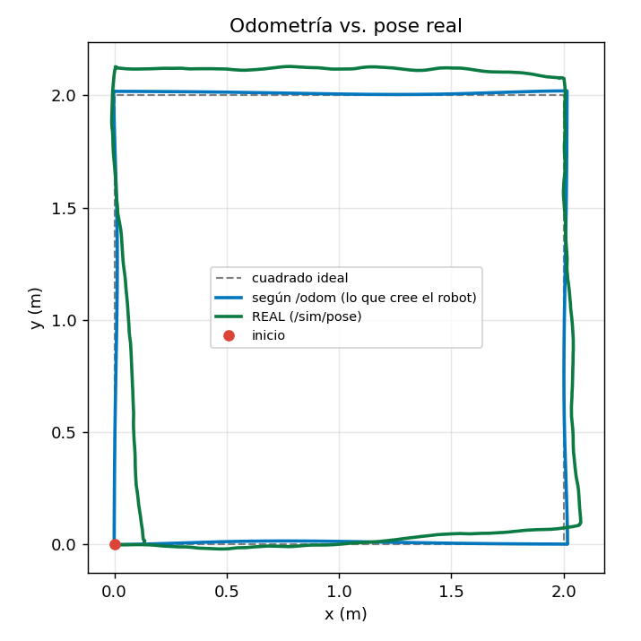

# RC-1 — Control PID: del simulador al robot real

**Grupo 8 · S-003** · Integrantes: [COMPLETAR] · RosCar 4 · `ROS_DOMAIN_ID=8` · ruido `low` (trabajo) y `medium` (estrés) · ganancias finales: ver `config/rc1_pid.yaml` · **Estado: simulador terminado; robot real pendiente (celdas `[ ]`)**

## (a) Predicción frente a medición (4 preguntas, escritas antes de correr)

| Pregunta | Predijimos | Medimos | ¿Se cumplió? |
|---|---|---|---|
| 1. Recta, solo P | ≥ 2 cruces; equilibrio en ≈ +2 cm (0.06/3); Kd amortigua | 1B: 2 cruces, centro +2.17 cm; 1C: 0 cruces, residuo ≈ 2.1 cm; 1D (Ki): 0.30 cm | Sí |
| 2. Cuadrado PID, `low`: cierre `/odom` / real | 5 / 20 cm; real > `/odom` | 3B: 0.3–1.0 / 37–89 cm; 3C: 0.1–0.7 / 13–42 cm | Dirección sí; `/odom` sobrestimado, real subestimado en 3B |
| 3. 1° de error de yaw | 3.49 cm en un lado; 9.79 cm en cuatro lados | No medido directamente. El yaw real difirió del de `/odom` entre 1° y 31° | Sirve de escala (≈ 10 cm por grado en cada esquina) |
| 4. Mismas ganancias en el robot | Asentamiento del giro mayor en el real (motores, `/odom` a ≈ 11 Hz, `max_angular` 1.0 frente a 2.0) | [ ] | [ ] |

## (b) Hoja de resultados (`hoja_resultados.csv`)

| Prueba | Ganancias | Simulador (`low`) | Meta | Robot real |
|---|---|---|---|---|
| 1A bang-bang | sin PID | \|e\| medio 6.27 cm; 3 cruces; no se asienta | – | – |
| 1B solo P | Kp 3 | \|e\| medio 6.03 cm; 2 cruces; no se asienta | – | – |
| 1C P + D | Kp 3, Kd 4 | \|e\| medio 3.10 cm; 0 cruces; residuo ≈ 2.1 cm | – | – |
| 1D PID | Kp 3, Ki 0.5, Kd 4 | \|e\| medio 2.53 cm; asienta en 5.80 s; error final **0.30 cm** | ≤ 2 cm (E2) | desvío: [ ] / [ ] / [ ] cm (E6, meta ≤ 5) |
| 2a / 2b / 2c | kp_yaw 1 / 10 / 10; kd_yaw 0 / 0 / 1.2 | sobreimpulso 0 / 4.3 / 0 %; asentamiento 3.83 / 1.20 / 1.34 s | – | – |
| 2p (propia) | kp_yaw 10, kd_yaw 0.6 | sobreimpulso 0 %; asentamiento **1.01 s**; error final 0.22° | ≤ 10 % y ≤ 3 s (E3) | error final: [ ]° (E5, meta ≤ 3°) |

## (c) Cierre `/odom` frente a real: cuadrado de 2 × 2 m (cm)

| Prueba | Sim `/odom` (media low) | Sim real (media low; corridas) | Sim `medium` (`/odom` / real) | Robot `/odom` | Robot cinta |
|---|---|---|---|---|---|
| 3A lazo abierto | 4.6 | **16.1** (10.8 / 12.8 / 24.6) | 10.2 / 24.8 | [ ] | [ ] (1 corrida) |
| 3B PID sobre `/odom` | 0.5 | **58.7** (37.3 / 88.7 / 50.0) | 0.5 / 46.0 | [ ] | [ ] (media de 3; meta ≤ 25 y < 3A) |
| 3C PID + Ki | 0.4 | **30.1** (41.6 / 13.4 / 35.3) | 0.4 / 56.8 | – | – |

**Por qué `/odom` y lo real no coinciden.** El simulador empuja y rota al robot (el piso) y `/odom` no ve esa rotación. El PID cierra el lazo sobre `/odom`: cree que cierra a < 1 cm mientras el robot real queda a 13–89 cm, con un yaw real de 329° a 377° frente a ≈ 360° de `/odom`. Con 1° de error por esquina el cierre ya es de ≈ 10 cm (pregunta 3). Por eso el lazo abierto (3A), que no depende de `/odom`, cerró mejor en el simulador, algo que en el robot real se espera al revés. La figura es la mejor corrida con PID (3C run 2, 13.4 cm). **E4:** la media de 3C (30.1 cm) cumple ≤ 40 cm, pero su corrida 1 (41.6 cm) no; la lectura de la meta (por corrida, media o al menos una) está por confirmar con el docente. No atribuimos la ventaja de 3C sobre 3B a Ki: también cambia `bias_w` y las corridas `low` varían hasta 51 cm entre sí.

## (d) Por qué cambió el comportamiento al pasar al robot

Esperábamos: motores con inercia y retardo (el simulador solo limita la aceleración); derrape de las 4 ruedas (`b_eff = χ·b`); `/odom` a ≈ 11 Hz frente a 50 Hz; sesgo real de motores en lugar de `bias_w`; error sistemático de `r` y `b_eff` en vez de ruido aleatorio; `max_angular` 1.0 frente a 2.0. **Observado:** [COMPLETAR tras el laboratorio, con la tabla de transferencia].

## (e) Qué cambiaríamos para el RC-2

[COMPLETAR con los datos del robot]. Borrador desde el simulador: cerrar el lazo con una medida independiente de `/odom` para el yaw; repetir las pruebas con más de 3 corridas para separar el efecto de Ki del ruido entre corridas.
